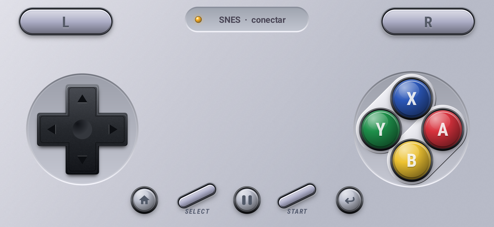
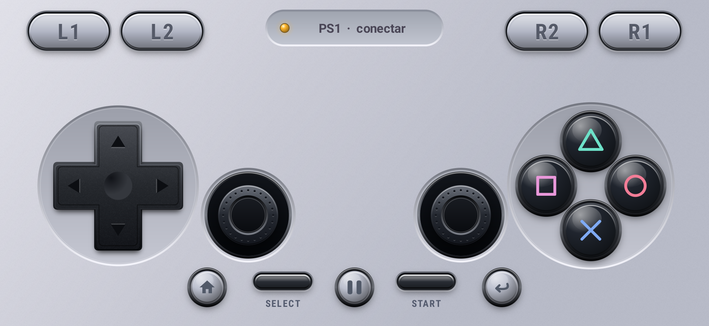
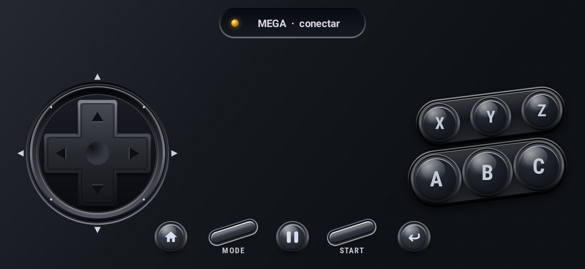
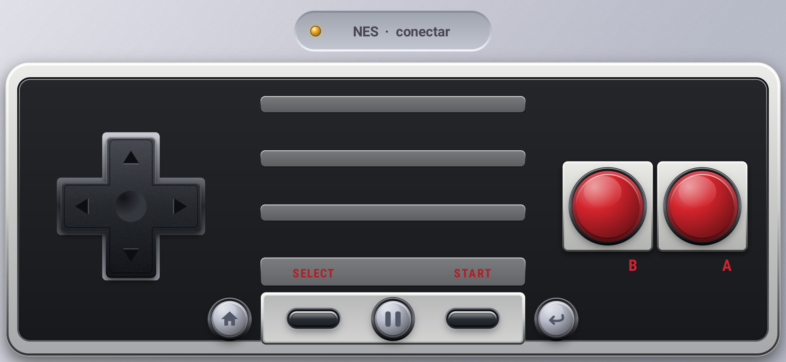
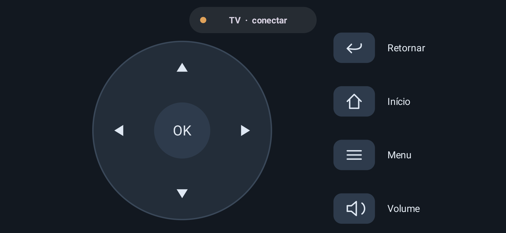
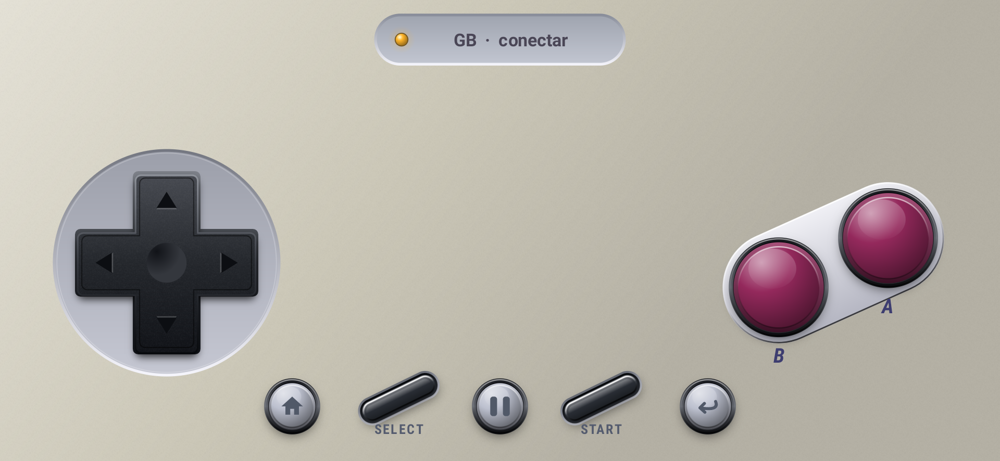
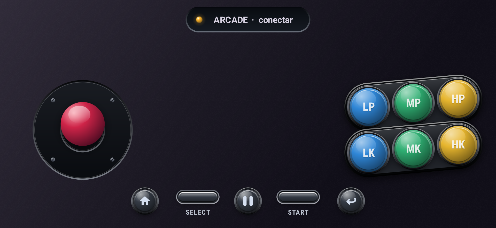

# RetroTV Pad

Controle Android para o [RetroTV Lite](https://github.com/RetroGame-TV/retrotv-lite): o celular vira o controle do console que está rodando na TV, com layouts próprios por console e troca automática de layout.

Versão 0.3.5-dev, Android 9+, sem root. Não é um emulador de celular: os jogos rodam na TV.

## Como é

| PS1 | Mega Drive |
|---|---|
|  |  |
| **NES** | **TV (sempre plana)** |
|  |  |
| **Game Boy** | **Arcade** |
|  |  |

Em todos os layouts, ⌂ volta ao menu principal do RetroTV, ↩ volta um passo e ❚❚ pausa. A aparência **clássica continua como padrão**. Para ativar o modo adicional, toque no chip do console > **Mais opções > Aparência dos controles > Realista**. A escolha fica salva e pode ser revertida para **Clássica** a qualquer momento.

No modo realista, os seis modelos de jogo — NES, SNES, PS1, Mega Drive, Game Boy e Arcade — têm acabamento tridimensional desenhado em Canvas: aros, rebaixos, plástico acetinado, botões convexos e analógicos de borracha. Ao apertar, a face afunda no encaixe fixo, diminui, escurece e perde a sombra de elevação. O Arcade tem alavanca com haste metálica e esfera inclinável. As formas e os símbolos são vetoriais; uma pequena textura procedural dá granulação ao material, sem imagens de controles ou botões. Skins importadas mantêm sua aparência. **O controle da TV permanece plano em qualquer aparência.**

Na TV, toque em **Volume** para aumentar ou diminuir sem fechar o painel. O volume usa a conexão do controle remoto do Google TV, na mesma rede Wi-Fi, e funciona também quando os jogos usam RetroTV ou HID. Se essa conexão ainda não existir, o próprio painel oferece **Conectar controle da TV**. Os botões físicos de volume do celular também ajustam a TV enquanto o app estiver aberto e conectado ao controle remoto; sem essa conexão, continuam com o comportamento normal do celular. O app não mostra uma porcentagem de volume sem confirmação da TV.

Capturas do modo realista em Android, em paisagem e sem conexão com uma TV. O visual acompanha os ajustes de tamanho e posição em **Personalizar**. Veja os [testes e limites da validação visual](docs/realistic-controls.md).

## Formas de conexão

| Rota | Para que serve | Requisito |
|---|---|---|
| **Jogar (RetroTV)** | jogar: botões, direcional segurado, analógicos, AUTO, Início e Retornar | RetroTV Lite aberto na TV; Wi-Fi na mesma rede (encontra a TV sozinho) ou Bluetooth RFCOMM; código de 4 dígitos no primeiro pareamento |
| **Bluetooth HID** | controle Bluetooth padrão, para qualquer app da TV | o fabricante do celular precisa oferecer o perfil Bluetooth HID Device |
| **Só menus (controle remoto da TV)** | navegar no Google TV e ajustar seu volume, sem precisar do RetroTV aberto | Google TV com o serviço de controle remoto (protocolo v2, porta 6467/6466) |

## Uso

1. Instale o APK no celular e abra o RetroTV Lite na TV.
2. No Pad, toque em **Conectar** e escolha **Jogar (RetroTV)**. Na primeira vez, digite o código que aparece na TV.
3. Com **AUTO** ligado, o layout acompanha o console do jogo aberto na TV. Também dá para escolher manualmente: NES, SNES, MEGA, PS1, GB, ARCADE e TV (controle remoto para navegar na galeria).
4. **Início** volta ao menu principal do RetroTV; **Retornar** volta um passo.

## Skins Delta

Menu ⋮ > Importar skin Delta (.deltaskin). Leitor próprio do formato público `info.json` (representações iPhone standard/edgeToEdge, retrato/paisagem, mappingSize, items, inputs, frame) e imagens PDF/PNG/JPEG, desenhadas localmente.

Suporte: NES, SNES, GB/GBC, Genesis e PS1; botões e direcional. GBA, DS, N64, telas de toque e filtros não são suportados. Limites: ZIP até 32 MiB e 128 entradas, `info.json` até 256 KiB, imagens até 8 MiB. Caminhos inseguros são recusados, e o pacote anterior é preservado se a importação falhar.

## Compilar

JDK 17+ (testado com JDK 21), Android SDK 35, Gradle wrapper 8.9, Kotlin 2.0.21, AGP 8.7.3.

    gradlew :retropad:assembleDebug :retropad:testDebugUnitTest :retropad:lintDebug

Saída: `retropad/build/outputs/apk/debug/retropad-debug.apk`. Nenhuma chave de publicação acompanha o projeto.

## Licença e créditos

Copyright (C) 2026 Davi Mattos e colaboradores do RetroTV. Licença **GNU GPL v3 ou posterior** (GPL-3.0-or-later); veja [LICENSE](LICENSE).

- **Inspiração:** [Bluke](https://github.com/arnav-kr/Bluke), de arnav-kr, que transforma o celular em teclado e controle Bluetooth. O RetroTV Pad é um projeto próprio e não usa código do Bluke; o controle Bluetooth HID foi escrito a partir da especificação USB HID 1.11.
- **Formato de skins:** [Delta](https://github.com/rileytestut/Delta), de Riley Testut. O importador é uma implementação própria do formato; nenhum código ou arte do Delta acompanha o app.

Os layouts nativos são desenhos próprios. Não há ROMs, BIOS ou logotipos de fabricantes no app; skins externas mantêm suas licenças. Versões até a 0.3.4 incluíam código do Bluke e seguem sob AGPL-3.0; a partir da 0.3.5 o projeto é independente.
