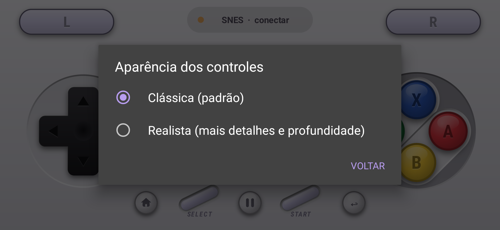
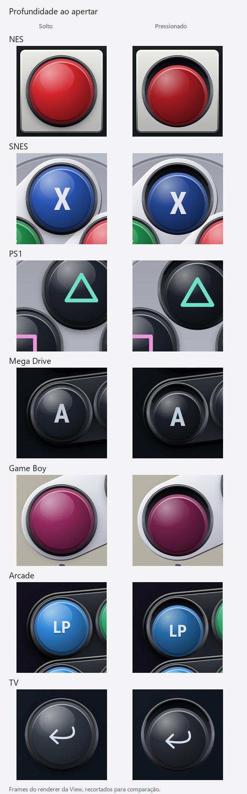
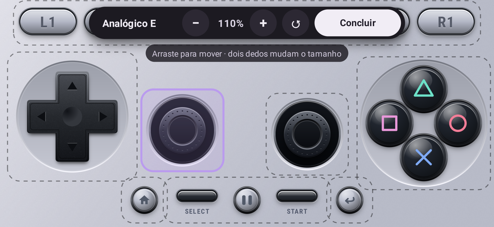
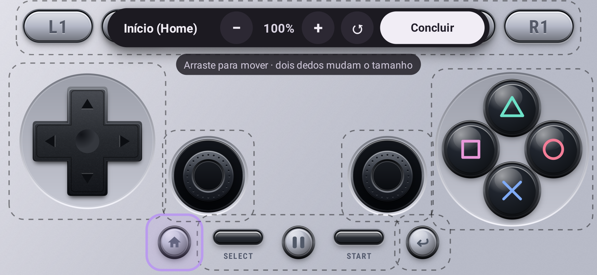
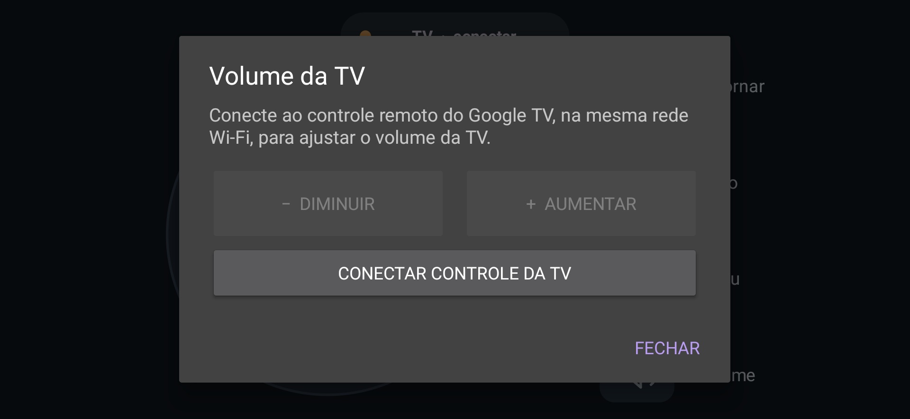

# Controles com acabamento tridimensional

Os quatro desenhos fornecidos como referência foram inspecionados visualmente. A implementação mantém a composição adaptável dos controles nativos e reproduz seus materiais em `RealisticPadArt`, usando paths, gradientes, contornos, sombras e símbolos vetoriais do Android Canvas. Game Boy e Arcade também recebem acabamento realista, derivado da mesma linguagem de materiais, pois não havia renders de referência para esses dois modelos. O controle da TV usa `FlatTvArt`: preenchimentos sólidos e traços simples, sem materiais, sombras ou efeito 3D, em ambas as aparências.

O visual é um **modo adicional e opcional**, disponível nos seis modelos de jogo. O padrão continua **Clássica**, inclusive para quem atualiza o app. Ative em **chip do console > Mais opções > Aparência dos controles > Realista**. A preferência fica salva; voltar a Clássica restaura o desenho anterior dos jogos. O renderer realista e sua textura são inicializados apenas quando necessários e nunca são usados no controle da TV. Skins importadas não mudam de aparência.



| Console | Acabamento |
|---|---|
| NES | Moldura clara chanfrada, painel preto rebaixado, faixas centrais, teclas de borracha e botões vermelhos em bases quadradas. |
| SNES | Carcaça cinza acetinada, ombros lilás, discos rebaixados e botões coloridos convexos com letras claras. |
| PS1 | Carcaça cinza, quatro ombros, símbolos coloridos desenhados por paths e dois analógicos com aros, concavidade e pontos de aderência. |
| Mega Drive | Plástico preto, aros claros no direcional e nas duas fileiras inclinadas, seis botões escuros e letras cinza. |
| Game Boy | Carcaça cinza quente, botões vinho em base inclinada, impressão azulada e teclas de borracha rebaixadas. |
| Arcade | Painel escuro, seis botões coloridos com aros e profundidade, alavanca com esfera brilhante, haste metálica e parafusos na base. |
| TV | Desenho plano, anel direcional com destaque da direção pressionada, OK independente e teclas Retornar/Início/Menu/Volume. |

São desenhos próprios. Não há imagens completas usadas como botões, modelos 3D, bibliotecas novas, logotipos ou assets extraídos das referências. A granulação usa um tile procedural de 64×64 pixels (16 KiB), criado uma vez por renderer e repetido por shader em uma única operação. As partes interativas continuam vetoriais. Não há animação contínua nem geração de ruído a cada evento.

## Integração e interação

`ControllerView` escolhe o novo renderer nos jogos somente quando o usuário ativa Realista e quando não está desenhando uma skin Delta importada. O renderer recebe os mesmos `PadControl` e `PadState` já usados pelo input. A aparência de pressão é imediata: o encaixe permanece fixo, a face desce de 2,5 a 4,5 dp, perde altura, escurece e deixa de projetar a sombra elevada; a borda interna superior aparece acima dela. Os ombros e as teclas Start/Select também afundam. O direcional inclina e os analógicos acompanham os eixos. Ao soltar ou cancelar o gesto, o desenho volta ao estado neutro. No Arcade a esfera inclina com a direção. Na TV, apenas a cor indica a direção ou tecla pressionada, sem simular profundidade.



Os jogos mantêm o método de layout, as áreas de toque, IDs/máscaras, rastreamento de dedos e editor. A TV tem uma coluna de quatro teclas para acomodar Volume. Essa tecla é uma ação de interface com máscara zero; ela não vira botão de jogo. As bases decorativas seguem as posições e dimensões finais dos controles após personalização. A Activity continua em `sensorLandscape`, como antes.

## Personalização independente

Analógico esquerdo, analógico direito, Início (Home) e Voltar têm grupos próprios de posição e tamanho, por console. A seleção no editor mostra **Analógico E**, **Analógico D**, **Início (Home)** ou **Voltar**. Arrastar, os botões −/+ e o gesto de dois dedos afetam somente a peça selecionada. Start/Select/Pause permanecem no grupo de sistema; no controle da TV, Menu/Volume permanecem juntos e Início/Voltar ficam separados.

Os ajustes anteriores dos grupos `sticks` e `system` são convertidos uma única vez ao construir o layout nativo. A conversão considera o centro do grupo antigo, a escala, o deslocamento e a correção conjunta nas bordas, para preservar tamanho e espaçamento. Cada novo grupo passa a salvar seus próprios deslocamentos normalizados. A migração registra um marcador por console/grupo, não sobrescreve ajustes individuais já existentes e mantém uma cópia dos valores antigos nas preferências. O reset ↺ limpa tanto os novos ajustes quanto os valores e marcadores antigos do console atual, impedindo que a configuração anterior reapareça.

Os limites da tela são aplicados individualmente, de modo que um analógico ou uma tecla encostando na borda não arraste seu par. As máscaras e eixos usados para jogar não mudaram.

| Analógico esquerdo selecionado | Início selecionado |
|---|---|
|  |  |

## Volume da TV

O botão Volume abre `TvVolumeDialog`, com Diminuir/Aumentar e sem fechamento a cada ajuste. Os comandos vão diretamente para `GoogleTvLink`, independentemente da rota de jogo RetroTV/HID. São injeções atômicas de tecla SHORT (direção 3), com keycode 24 para aumentar e 25 para diminuir; não deixam uma tecla pressionada em caso de desconexão. Referências de protocolo: [schema do Android TV Remote v2](https://github.com/tronikos/androidtvremote2/blob/main/src/androidtvremote2/remotemessage.proto) e [KeyEvent do Android](https://developer.android.com/reference/android/view/KeyEvent).

O painel oferece conexão Google TV por Wi-Fi quando necessária e desativa os ajustes se essa conexão cair. A configuração usa descoberta e código de pareamento na TV; não exige permissão Bluetooth nem interrompe a conexão de jogo. Os botões físicos de volume do celular funcionam enquanto o app está em primeiro plano e conectado ao remoto, inclusive com o painel aberto. Sem conexão, o Android mantém o controle normal do volume local. Ao sair do app, a posse das teclas é limpa. Nenhum número de volume é inventado, e não há chamadas ao AudioManager do celular.

| TV plana | Painel sem TV conectada |
|---|---|
|  |  |

## Validação em 27/10/2026

- Compilação do app e do APK de testes com JDK 21, SDK 35 e Gradle 8.9.
- 44 testes JVM passaram, incluindo volume, ajustes independentes/migração e seis testes da nova fila de envio sem espera artificial dos analógicos.
- 18 testes Android passaram em Android 11/API 30 x86 virtual: três existentes, sete em `RealisticControllerTest`, dois em `TvVolumeAndroidTest`, quatro em `CustomizationAndroidTest` e dois em `PadLatencyAndroidTest`.
- Envio real via TCP local, rajada de 500 movimentos com pressão/soltura preservadas, eventos da View e microbenchmark de serialização. Veja [mudanças e limites da validação de latência](input-latency.md).
- Os quatro controles independentes foram arrastados e redimensionados por MotionEvent sem alterar seus vizinhos, com recriação da View para verificar persistência. A migração dos ajustes antigos foi conferida uma única vez e o reset foi testado para impedir o reaparecimento dos valores antigos.
- O painel de volume foi testado com um destino simulado: aumentar/diminuir repetidamente sem fechar, tecla física com painel aberto, atualização para desconectado e botão de conexão.
- O gesto no botão Volume foi testado via MotionEvent: abre somente após toque completo, cancelar não abre e nenhum botão de jogo é enviado.
- Modo clássico como padrão; preferência realista preservada ao recriar a View; mesmas áreas de toque nos dois modos; retorno pixel a pixel à aparência clássica ao desativar; entrada liberada ao alternar.
- Todos os botões dos sete modelos foram pressionados e soltos via `MotionEvent`, conferindo suas máscaras.
- Direcional diagonal com um segundo dedo em botão, soltura independente e `ACTION_CANCEL` nos sete modelos.
- PS1 com os dois analógicos e um terceiro dedo em botão, seguido de cancelamento.
- Limites das áreas de toque em Views de 2400×1080, 1920×1080, 1440×1080 e 1080×1920; liberação de entrada ao redimensionar ou abrir o editor.
- Renderização pressionada diferente da neutra e retorno pixel a pixel ao desenho original após cancelar, nos sete modelos.
- Resposta visual de pressão e soltura do direcional em todos os modelos, incluindo a alavanca Arcade e o anel da TV.
- Lint: zero erros e 12 avisos; nove já existiam e três são sugestões de recursos de tradução do novo painel. Nenhum check foi desativado.
- Capturas dos seis modelos de jogo e da TV plana no renderer Android em 1920×886/420 dpi. O painel de volume foi capturado sem conexão real; seu funcionamento com TV física continua pendente.

Comandos reproduzíveis (substitua o serial pelo seu emulador):

```sh
./gradlew :retropad:assembleDebug :retropad:assembleDebugAndroidTest :retropad:testDebugUnitTest :retropad:lintDebug
adb -s emulator-5558 install -r retropad/build/outputs/apk/debug/retropad-debug.apk
adb -s emulator-5558 install -r retropad/build/outputs/apk/androidTest/debug/retropad-debug-androidTest.apk
adb -s emulator-5558 shell am instrument -w -e class org.retrotv.pad.PadAndroidTest,org.retrotv.pad.RealisticControllerTest,org.retrotv.pad.TvVolumeAndroidTest,org.retrotv.pad.CustomizationAndroidTest,org.retrotv.pad.PadLatencyAndroidTest org.retrotv.pad.test/androidx.test.runner.AndroidJUnitRunner
adb -s emulator-5558 shell am start -W -S -n org.retrotv.pad/.PadActivity --es previewConsole SNES
```

O seletor `previewConsole` já existe apenas nas builds de depuração. Também aceita `NES`, `PS1`, `MD`, `GB`, `ARCADE` e `TV`. Aguarde o desenho completo antes de capturar a tela.

Para exportar pares de frames neutro/pressionado do renderer da View, acrescente `-e exportFrames 1` ao comando de instrumentação. Os PNGs ficam em `files/realistic-review` no diretório interno privado do app; em build debug, podem ser lidos com `adb exec-out run-as org.retrotv.pad cat files/realistic-review/snes-pressed.png`. Esses frames são desenhados em Canvas de bitmap; as imagens principais do README são capturas do app no renderer da janela Android.

Esta validação cobre compilação, renderer e interação local. O modo realista executa mais operações de desenho que o clássico; não há benchmark comparativo de FPS, latência, energia ou memória em celular físico, nem teste de conexão real celular–TV ou Bluetooth. Não há loop contínuo de animação. A fidelidade ao material das referências é aproximada por desenho vetorial, sem prometer igualdade fotográfica com os renders.
